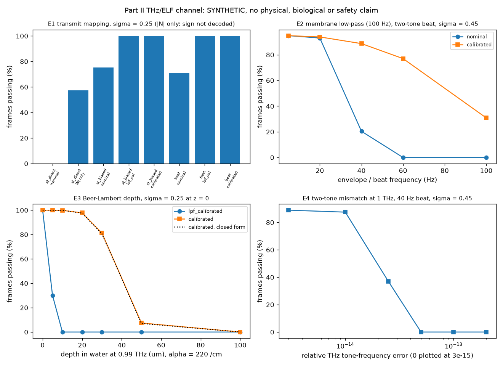

# Digital to Wave 2 THz Validity

**An engineering-validity study of the THz human-wave interface (HWI) equations in Mun Seok Lee's *Digital to Wave* Part II preprint.** It has three parts:
- an equation inventory with page numbers;
- dimensional checks and standard-reference plausibility numbers;
- a seeded, protocol-locked synthetic channel benchmark that carries the Part I signed-amplitude sine encoding through Part II's THz/ELF mechanisms.

[](https://github.com/sparkainlp-x/digital-to-wave-2-thz-validity/actions/workflows/tests.yml)
[](LICENSE)
[](.github/workflows/tests.yml)
[](#scope-what-it-is-not)

Evidence tags: **SYNTHETIC** means produced by code in this repository; rerun it yourself. **TARGET** means planned, not done. **UNRUN** means not executed.

## Scope: what it is not

**No physical, biological or safety claim is made.**

- **Not a model of tissue, neurons, ion channels, the brain, a brain–computer interface or THz hardware.** The channel benchmark is dimensionless after an explicit normalisation. It borrows only the functional form of Part II's mechanisms: square-law rectification, a 100 Hz low-pass, Beer–Lambert depth loss and two-tone beating.
- **Not a safety assessment.** The validity numbers are order-of-magnitude evaluations of the printed equations with cited reference values. They show what the equations themselves imply. They are not exposure calculations for any device.
- **Not a review or endorsement by the source author.** Mun Seok Lee is credited as the author of the source equations only. He has not reviewed or endorsed this software.
- **Not a preregistration.** Conditions were fixed in a [protocol lock](reports/protocol-lock.md) before the full run. The lock commit is meant to be pushed and pass CI before the results. The design was ported from an earlier local run with another seed, which the lock discloses.

## Sources and attribution

> Lee, Mun Seok (2026). *Digital to Wave: LGD In Situ Wave Memory-Human Wave Integrated Interface-Metaverse Hologram- Wave Affective AI.* Preprint (Part II; patent pending), Zenodo. https://doi.org/10.5281/zenodo.21947108 (all versions: [10.5281/zenodo.21947107](https://doi.org/10.5281/zenodo.21947107)). CC BY 4.0.

> Lee, Mun Seok (2026). *Digital to Wave: Paradigm Shift in Quantum Wave-Based Computing and Lab-Grown Diamond Memory.* Preprint (Part I), Zenodo. https://doi.org/10.5281/zenodo.21947036 (all versions: [10.5281/zenodo.21464222](https://doi.org/10.5281/zenodo.21464222)). CC BY 4.0.

Page numbers refer to the PDF pages. Equations are paraphrased; no text or figures from the preprints are redistributed.

The Part I encoder, the matched-filter decoder and the statistics helpers are **vendored verbatim** from the [Digital to Wave Testbench](https://github.com/sparkainlp-x/digital-to-wave-testbench) v0.4.1 (commit `f4b3934`, doi:[10.5281/zenodo.23134616](https://doi.org/10.5281/zenodo.23134616)). See [`d2w_thz/_vendor/PROVENANCE.json`](d2w_thz/_vendor/PROVENANCE.json), which records the file, commit and SHA-256 of every vendored file and definition.

## Layout

| path | content |
|---|---|
| [`d2w_thz/validity.py`](d2w_thz/validity.py) | Equation inventory (page and class a/b/c), SI dimension checks, Part II HWI equations, engineering-validity report |
| [`d2w_thz/references.py`](d2w_thz/references.py) | Physical constants and standard reference values, each with its source |
| [`d2w_thz/thz_channel.py`](d2w_thz/thz_channel.py) | Transmit mappings, membrane low-pass, depth gain, receivers |
| [`d2w_thz/benchmark.py`](d2w_thz/benchmark.py) | Locked protocol (seeds, grid), statistics, validator, artifacts, plot |
| [`d2w_thz/_vendor/`](d2w_thz/_vendor/) | Verbatim testbench v0.4.1 code and its provenance |
| [`reports/protocol-lock.md`](reports/protocol-lock.md) | Protocol fixed before the full run |
| [`tests/`](tests/) | Vendor provenance, hash lock, channel exactness, validity, protocol, port equivalence, committed-result checks |
| [`tools/`](tools/) | `reproduce_all.sh` and `verify_vendor.py` (checks the vendored code against a testbench checkout) |
| `artifacts/` | Generated JSON/CSV/PNG with `SHA256SUMS` (added by the run commit) |

## Why vendored rather than a Git dependency

The testbench is a flat set of top-level modules. It is not on PyPI, and it pins the same NumPy/Matplotlib versions. Vendoring was chosen over a Git dependency for three reasons:
- **Zenodo is self-contained.** The Zenodo archive of a release contains everything needed to run it. A Git dependency would fetch code from GitHub at install time, and that code is not part of the archive.
- **No network for the core code.** CI and users do not need the network to install the core code.
- **Verifiable.** The provenance is mechanically checked. `tests/test_vendor_provenance.py` checks the recorded hashes offline. CI also checks out the testbench at tag `v0.4.1` and runs `tools/verify_vendor.py` against it.

## Install and usage

```bash
python -m pip install -e ".[test]" ruff
python -m pytest              # tests
ruff check .                  # lint
sha256sum -c MODULES.sha256   # locked modules unchanged
python -m d2w_thz.benchmark   # full protocol (about 20 s), writes artifacts/
tools/reproduce_all.sh        # same, and refreshes artifacts/SHA256SUMS
```

## Results (SYNTHETIC; master seed 20261013; run from lock commit `6ff37d6` with a clean tree)

All numbers below come from `python -m d2w_thz.benchmark`, stored in [`artifacts/`](artifacts/). The full equation
inventory, the dimension checks and the sources are in
[`reports/equation-inventory-and-validity.md`](reports/equation-inventory-and-validity.md).

### Equation inventory (Part II, by PDF page)

- **Simulatable or checkable, consistent standard physics** (HWI section):
  - Fresnel and Beer–Lambert (p. 34)
  - rectification and intensity (p. 35)
  - induced potential (p. 36)
  - minimum intensity (p. 37; its expanded form drops a κ² term, ≈ 4%)
  - thermal time (pp. 29, 38)
  - SNR (p. 40; its k_B·T = 4.11×10⁻²¹ J corresponds to 298 K, not 310 K)
  - 5–60 Hz gating and the 100 Hz low-pass (pp. 25, 27)
  - the two-tone THz beat (pp. 45–47)
- **Dimensionally inconsistent:** the p. 29 "HWI Standard Equation". Its right side has units of J m⁻², not W m⁻²,
  and its exponential depth factor has become linear. It is the only equation that fails the dimension check.
- **Checkable and implausible:** the 79.6 ZB lab-grown-diamond claim (pp. 3, 5, 11) implies ≈ 96 bits per diamond unit
  cell (≈ 12 per atom).
- **Too vague to implement (c):**
  - CVD imprint and STED locking (pp. 17–19)
  - memory copy/erase, STDP hub, hippocampal tensor and J_Holo (pp. 43–57)
  - hologram/CMB coupling (pp. 64–77)
  - wave affective AI (pp. 86–94)
- **Generic standard pieces** inside those sections: oscillator, phonon sum, interference, phase integral, Fourier
  transform, Rodrigues rotation and PLL.

### Plausibility of the HWI equations (assumptions favour the paper)

Assumptions: water at 1 THz (n = 2.1, α = 220 cm⁻¹, T = 0.850), a ZnTe-level χ⁽²⁾ = 1.37×10⁻¹⁰ m/V (bulk water: 0),
membrane d = 5 nm, ε = 2, threshold 15 mV.

| quantity | value |
|---|---|
| coupling at the surface (p. 36) | 2.19×10⁻¹⁶ V per W m⁻² |
| intensity needed (p. 37) at 0 / 45 µm / 100 µm / 1 mm / 2 mm | 10^13.8 / 10^14.3 / 10^14.8 / 10^23.4 / 10^32.9 W m⁻² |
| surface value vs ICNIRP long-exposure skin limit (1000 W m⁻²) | 10^10.8 × |
| incident field at the surface | 10^8.36 V m⁻¹ ≈ 76 × air breakdown (3 MV m⁻¹) |
| time to heat by 0.5 K at the surface (adiabatic) | 1.6 ps (< 2 THz periods) |
| penetration depth 1/α in water | 81 / 60 / 45 / 29 µm at 0.30 / 0.60 / 0.99 / 1.98 THz |
| thermal time τ_th for w = 10 µm / 100 µm / 1 mm | 0.17 ms / 17 ms / 1.74 s |
| SNR at threshold (p. 40, q = 13 e₀) | 7.3 (it does not show that the threshold can be reached) |

### Channel benchmark

Results are passing frames out of 12,000 per cell (6 vectors × 2,000).

| condition | nominal | LPF-calibrated | calibrated (oracle) |
|---|---|---|---|
| single-tone direct \|E\|², σ = 0 / 0.25 / 0.45 | 0 / 0 / 0 | — | — (magnitude-only \|N\|: 12,000 / 6,883 / 3,153) |
| single-tone biased, σ = 0.25 / 0.45 | 9,041 / 2,626 | 12,000 / 10,787 | 12,000 / 10,787 |
| two-tone beat, σ = 0.25 / 0.45 | 8,528 / 2,445 | 11,999 / 10,743 | 11,999 / 10,743 |
| two-tone beat, σ = 0.45, envelope 5 / 20 / 40 / 60 / 100 Hz | 11,390 / 11,166 / 2,452 / 0 / 0 | 11,389 / 11,270 / 10,647 / 9,246 / 3,703 | same |
| two-tone beat, σ = 0.25, depth 0 / 5 / 10 / 20 / 30 / 50 / 100 µm | 8,492 / 0 / 0 / 0 / 0 / 0 / 0 | 12,000 / 3,610 / 0 / 0 / 0 / 0 / 0 | 12,000 / 11,999 / 11,984 / 11,732 / 9,749 / 892 / 0 |
| two-tone beat, σ = 0.45, relative tone error 0 / 1e-14 / 2.5e-14 / ≥ 5e-14 | 2,465 / 4,091 / 3,259 / 0 | 10,675 / 10,504 / 4,433 / 0 | same |

What the table shows:
- **Sign:** direct square-law rectification destroys the Part I sign exactly. A bias or two-tone beat restores it.
- **Low-pass:** the 100 Hz membrane low-pass defeats the nominal decoder from 40 Hz upward (phase lag). A receiver that
  knows the filter recovers most frames up to 60 Hz.
- **Depth:** even the oracle receiver, which knows the depth loss, collapses between 30 and 100 µm. That is within about
  one to two penetration depths.
- **Tone stability:** the two-tone link needs a relative THz tone stability better than about 2.5×10⁻¹⁴.

**Closed-form check:** the prediction lies inside the pooled Wilson 95% interval in 73 of 75 cells that have one. The two
exceptions are one condition (two-tone beat, σ = 0.25, LPF-calibrated and oracle receivers): 1 failure where 0.11 were
expected, which has probability ≈ 10%.



## Reproduction

- **Run:** `tools/reproduce_all.sh` regenerates every artifact in about 20 s. CSV and PNG files are byte-identical
  between runs with the pinned NumPy 2.4.6 and Matplotlib 3.11.2. CI regenerates them on Python 3.11–3.13 and compares
  them byte for byte.
- **Provenance:** the results JSON records the lock commit (`6ff37d6`), a clean tracked tree and the SHA-256 of every
  package file. `tests/test_committed_results.py` (written before the run) re-runs two cells at full size and compares
  them with the committed CSV.
- **Port check:** `tests/test_port_equivalence.py` confirms that the code reproduces, bit for bit, the counts of the
  earlier local run of the same design in the testbench (seed 20261012).

## Limitations

- The channel is dimensionless. Noise is IID Gaussian in units of the unit-value amplitude at z = 0. The THz carrier is not sampled; its |E|² is averaged analytically.
- The membrane is an idealised first-order low-pass with a zero initial state. At 5 Hz (fs = 80 Hz) it is close to all-pass.
- The `calibrated` receiver is an oracle: it knows the low-pass and depth gains. No carrier, gain or timing recovery is attempted.
- The validity numbers use an extreme χ⁽²⁾ upper bound (ZnTe level). Bulk liquid water has χ⁽²⁾ = 0 in the dipole approximation, so real tissue is expected to be far weaker.
- Water at 0.99 THz stands in for skin; in vivo skin is of the same order or higher. One frequency (1 THz) is evaluated in detail.
- The fixed six-vector panel and the tolerance (0.25) are testbench choices.

## Citation

Archived on Zenodo: concept DOI [10.5281/zenodo.23375690](https://doi.org/10.5281/zenodo.23375690) (all versions). Version DOI for v0.1.0: [10.5281/zenodo.23375691](https://doi.org/10.5281/zenodo.23375691).

See [CITATION.cff](CITATION.cff). Please also cite the Part II preprint (source of the equations), the Part I preprint (source of the encoding) and the testbench.

## License

This software is available under the GNU Affero General Public License v3.0 only (AGPL-3.0-only); see [LICENSE](LICENSE).

Organizations that want to use it in proprietary products or services without AGPL obligations can contact the author about a commercial license via https://sparkainlpx.xyz. See [COMMERCIAL-LICENSE.md](COMMERCIAL-LICENSE.md).
